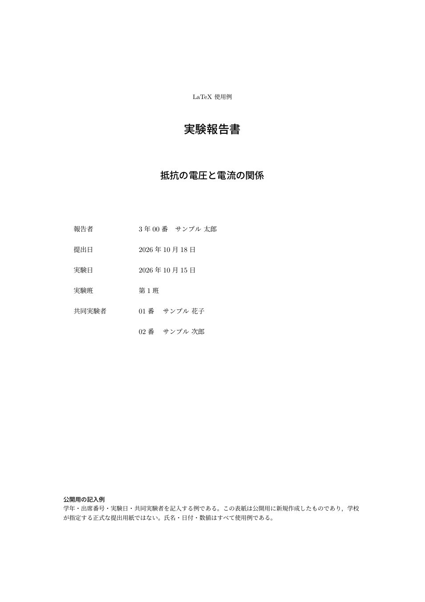

# Portable LaTeX Environment

VS Codeで親フォルダを一つ開き、**実験・課題ごとに独立したフォルダでレポートを作る**ための環境です。
共有するエディター設定は親の `.vscode/` に置き、本文とビルド設定は各レポートに置きます。
ユーザーディレクトリの設定や、個人用VS Codeプロファイルには依存しません。

共有設定には編集後1秒の自動保存、保存時ビルド、インデントの自動判定、文書の折り返し・補完を含めます。
文書の自動整形は行わず、テーマ・フォント・PDFの表示方法などは各自で選べます。
詳しい設定一覧は [.vscode/README.md](.vscode/README.md) を参照してください。



## フォルダ構成

```text
latex-environment/
├── .vscode/                         親フォルダで共有する設定
├── 00-使用例/
│   ├── 01-学校形式-upLaTeX/          学校の記述方法に近い最初の例
│   ├── 02-学校形式-pLaTeX/           pLaTeXを使う場合の例
│   ├── 03-数式とグラフ/              分割本文・CSV・数式・文献
│   ├── 04-欧文/                      pdfLaTeX / XeLaTeX
│   └── 05-biblatexとBiber/           LuaLaTeXによる文献管理
├── scripts/                         ビルド用スクリプト
├── docs/                            完成PDF・手順・検証記録
└── .github/workflows/                GitHub Actions
```

自分のレポートは、例えば次のように親フォルダの直下へ追加します。
`.vscode/` は一つを共有し、`.latexmkrc` と `export/` は実験ごとに分けます。

```text
latex-environment/
├── .vscode/
├── 00-使用例/
├── 01-光センサの使い方/
│   ├── .latexmkrc
│   ├── 実験報告書.tex
│   ├── school-report-example.sty
│   └── export/                      この実験のPDF・補助ファイル
└── 02-次の実験/
    ├── .latexmkrc
    ├── レポート.tex
    └── export/                      別の実験の出力先
```

`01-光センサの使い方` と `02-次の実験` は運用例であり、初期状態では作成されていません。
ルートには共通の `main.tex` や `.latexmkrc` を置きません。

## 最初に試す

1. TeX Live、VS Code、拡張機能 **LaTeX Workshop** を用意します。
2. このリポジトリのルート（`.vscode` と `00-使用例` があるフォルダ）をVS Codeで開きます。
3. `00-使用例/01-学校形式-upLaTeX/実験報告書.tex` を開きます。
4. 保存するか、**LaTeX Workshop: Build LaTeX project** を実行します。

PDFは、開いたレポートのフォルダ内の `export/実験報告書.pdf` に生成されます。
**LaTeX Workshop: View LaTeX PDF file** で表示できます。
別のレポートをビルドするときは、そのレポートのルートTeXファイルを開いてから実行してください。

## 使用例

| フォルダ | エンジン | 内容 | 完成見本 |
| --- | --- | --- | --- |
| [01-学校形式-upLaTeX](00-使用例/01-学校形式-upLaTeX) | upLaTeX + dvipdfmx | 学校に近い書き方、表紙、目的・方法・結果・考察 | [PDF](docs/samples/school-uplatex.pdf) |
| [02-学校形式-pLaTeX](00-使用例/02-学校形式-pLaTeX) | pLaTeX + dvipdfmx | pLaTeX文書と設定の対応 | [PDF](docs/samples/school-platex.pdf) |
| [03-数式とグラフ](00-使用例/03-数式とグラフ) | upLaTeX | 分割本文、数式、表、CSVグラフ、BibTeX | [PDF](docs/samples/report.pdf) |
| [04-欧文](00-使用例/04-欧文) | pdfLaTeX | 欧文、数式、表、XeLaTeXへの切替 | [PDF](docs/samples/english.pdf) |
| [05-biblatexとBiber](00-使用例/05-biblatexとBiber) | LuaLaTeX | 日本語文献とBiber | [PDF](docs/samples/bibliography.pdf) |

学校形式の例は、`plautopatch`、`jsarticle`、`amsmath`、`graphicx`、`okuverb` を使います。
学年・出席番号、報告者、提出日、実験日、班、共同実験者を記入し、
本文を「目的・理論・実験方法・実験結果・考察・参考文献・感想」に分けています。

表紙用の `school-report-example.sty` は公開用に新規作成したもので、学校指定の様式ではありません。
学校の `r08ec-exp.sty` は同梱していません。
手元の授業で指定されたスタイルを使う場合は、そのスタイルを各実験フォルダに置き、
本文の `\usepackage` を学校の指定に合わせてください。
氏名・日付・測定値はすべて例であり、実測データや実在の学生情報は含みません。

## 自分の実験フォルダを追加する

1. `00-使用例` 内の近い例をコピーし、親フォルダ直下に `01-実験名` などの名前で配置します。
2. 本文・題名・著者等を書き換えます。TeXファイル名は自由です。
3. そのTeXファイルと同じ場所に `.latexmkrc` と必要なスタイル・画像を置きます。
4. 親フォルダをVS Codeで開いたまま、対象のTeXファイルをビルドします。

ビルド済みの例をコピーする場合、生成物の `export/` はコピー不要です。
各フォルダの設定は独立しているため、ある実験のエンジン変更は別の実験には影響しません。
分割した本文では `% !TeX root = ../main.tex` などを使って、その実験のルート文書を指定します。

Windows版latexmk / Perlでは、「表」など一部の文字を含むフォルダ名で問題が起きる場合があります。
移植性を優先する実レポートには `01-light-sensor` のような半角英数字の名前がおすすめです。
今回確認した日本語名と制限は[検証記録](docs/VALIDATION.md)に記載しています。

## ターミナルからビルドする

親フォルダで、使用例の短い名前を指定します。省略時は `school` です。

```powershell
.\scripts\build.ps1 school
.\scripts\build.ps1 school-platex
.\scripts\build.ps1 report
.\scripts\build.ps1 english
.\scripts\build.ps1 bibliography
```

追加した実験にはフォルダ名を指定できます。

```powershell
.\scripts\build.ps1 -Project '01-光センサの使い方'
.\scripts\build.ps1 -Project '02-次の実験' -MainFile 'レポート.tex'
```

`-MainFile` 省略時は `main.tex`、またはフォルダ内に一つだけあるTeXファイルを選びます。
相対フォルダ名は呼び出した場所ではなく、このリポジトリのルートから解決します。
絶対パスを指定することもできます。
PowerShellヘルパーは5.1以降に対応し、呼び出し元の環境変数を終了時に復元します。

macOS / Linuxでは次のように使います。

```sh
sh scripts/build.sh school
sh scripts/build.sh report
sh scripts/build.sh './01-光センサの使い方'
sh scripts/build.sh './02-次の実験' 'レポート.tex'
```

直接実行する場合は、対象のTeXファイルがあるフォルダで次を使います。

```powershell
$env:TEXLIVE_WINDOWS_TRY_EXTERNAL_PERL = '0'
latexmk -norc -r .latexmkrc '実験報告書.tex'
```

最初の環境変数はWindows版TeX Liveの内蔵Perlを選ぶ指定で、他OSでは不要です。
VS Codeのビルドツール・新規ターミナルとヘルパーには指定済みです。

## 学校のTeX Liveを使う場合

学校の手順でTeX Liveを導入済みなら、本体を再インストールする必要はありません。
今回の自動ビルドには **latexmk** が必要です。
学校の軽量構成にない場合は、TeX Liveマネージャで不足分を追加してください。
USB版では、VS Codeから `latexmk`・`uplatex`・`dvipdfmx` を見つけられるPATHも必要です。
[学校の導入手順](https://www.nagaoka-ct.ac.jp/ec/labo/visu/usb/tex2/texlive.shtml)

学校形式の2例には、PGFPlots、siunitx、Biberは不要です。
それらは数式とグラフ・文献管理の例で使います。
学校のTeXworksでpLaTeXを選んでいた文書にはpLaTeXの設定を、
upLaTeXを選んでいた文書にはupLaTeXの設定を使ってください。
文字コードはUTF-8を前提とします。
[学校のTeXworks・テンプレート説明](https://www.nagaoka-ct.ac.jp/ec/labo/visu/usb/tex2/texworks.shtml)

サンプル全体はTeX Live 2026で検証しています。
拡張例にはLuaTeX-ja、Harano Aji、PGFPlots、siunitx、biblatex、Biber等が必要です。
TeX Liveのフルインストールには含まれます。最小構成では必要なものだけ追加します。

## エンジンと清掃

各レポートの `.latexmkrc` に既定のエンジンを保存します。

```perl
my $engine = $ENV{'LATEX_ENGINE'} || 'uplatex';
```

値は `uplatex`、`platex`、`lualatex`、`pdflatex`、`xelatex` です。
CLI・CIでは `LATEX_ENGINE` があれば優先します。
学校形式の例はエンジンを固定したクラス指定なので、それに合う設定を使用してください。
数式とグラフの例はupLaTeX・pLaTeX・LuaLaTeXに対応します。

エンジン切替前に補助ファイルを清掃します。

```powershell
.\scripts\build.ps1 report -Clean
.\scripts\build.ps1 report -Engine lualatex
```

```sh
sh scripts/build.sh report --clean
LATEX_ENGINE=lualatex sh scripts/build.sh report
```

通常清掃は `latexmk -c` です。PDFまで消す `-C` は使いません。
自動清掃は行わず、増分ビルド用ファイル・ログ・SyncTeXを保持します。
`-norc -r` でプロジェクト設定を明示的に読み、他PCのユーザー設定に依存させません。
エンジン指定の `% !TeX program` / `% !LW recipe` はVS Codeでは使いません。
学校形式の先頭コメントはTeXworksでも開けるように残しています。

## 公開・検証・ライセンス

[公開手順](docs/PUBLISHING.md)と[検証記録](docs/VALIDATION.md)を参照してください。
GitHub Actionsは使用例の8通りをビルドし、PDFをArtifactsに保存する設定です。
実際のGitHubでの実行結果は、公開後にActionsで確認してください。
[xu-cheng/latex-action](https://github.com/xu-cheng/latex-action)

このリポジトリの設定・ヘルパー・新規作成した使用例は[MIT License](LICENSE)です。
TeX Live、各パッケージ、フォント、学校配布のスタイルは同梱せず、各配布元の条件に従います。
